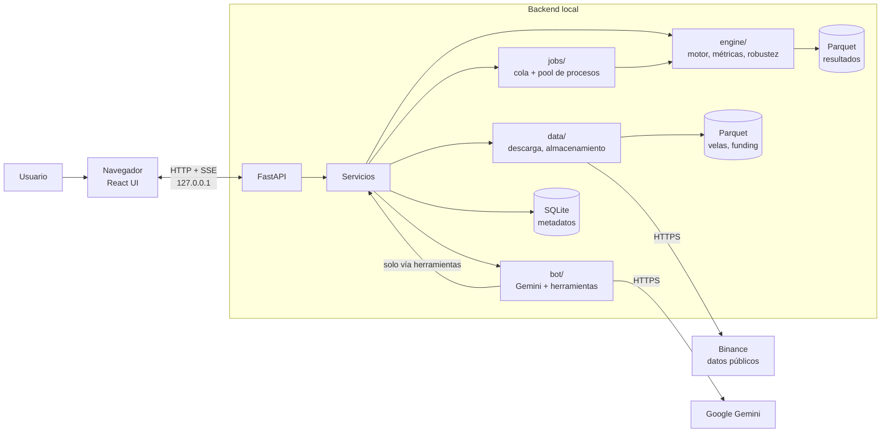
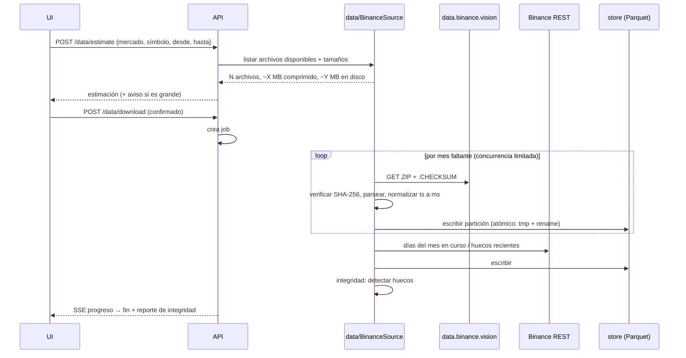
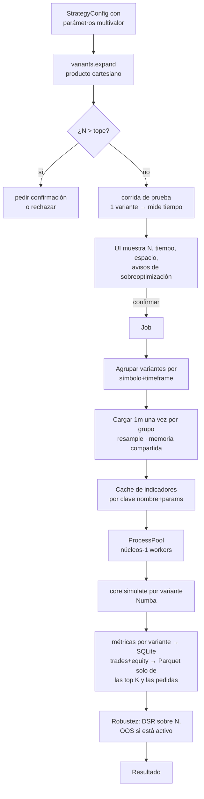
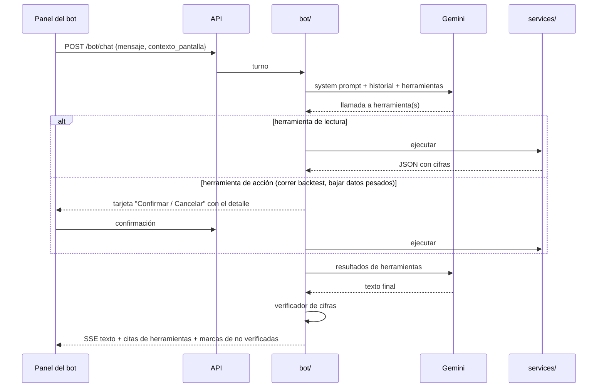
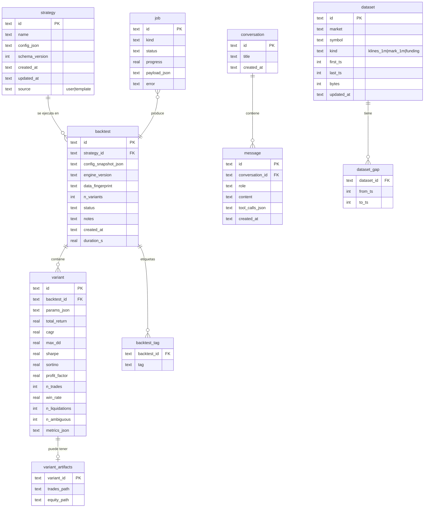

# WICK — Arquitectura

> Diagramas en Mermaid (GitHub los renderiza). Este documento define módulos, responsabilidades, flujos, modelo de datos y contratos de API.

---

## 1. Vista general



**Reglas de dependencia entre módulos** (verificadas con tests de importación):
- `engine/` es **puro**: no importa `api/`, `bot/`, `jobs/` ni hace red ni E/S de disco salvo leer arrays que le pasan. Recibe arrays NumPy y un config validado, y devuelve resultados.
- `bot/` **nunca** importa `engine/` directo: llama a funciones de `services/`, las mismas que usa la API.
- `api/` es delgada: valida, delega en `services/` y serializa.
- `data/` es la única capa que habla con Binance.

---

## 2. Estructura del repositorio

```
wick/
├── CLAUDE.md                     # reglas permanentes para Claude Code
├── LICENSE                       # GPL-3.0
├── README.md
├── docs/                         # estos documentos + decisiones (ADR)
│   └── adr/                      # 0001-*.md: una decisión por archivo
├── backend/
│   ├── pyproject.toml / uv.lock
│   ├── src/wick/
│   │   ├── main.py               # crea la app FastAPI, monta estáticos
│   │   ├── config.py             # rutas (platformdirs), settings
│   │   ├── api/                  # routers: data, strategies, backtests, jobs, bot, settings, guide
│   │   ├── services/             # lógica de aplicación (la usan api y bot)
│   │   ├── data/
│   │   │   ├── sources/base.py   # Protocol DataSource
│   │   │   ├── sources/binance.py
│   │   │   ├── store.py          # lectura/escritura Parquet, particiones
│   │   │   ├── integrity.py      # huecos, checksums, reporte
│   │   │   └── resample.py
│   │   ├── engine/
│   │   │   ├── schema.py         # StrategyConfig (Pydantic), versión de esquema
│   │   │   ├── indicators/       # un archivo por indicador + registro
│   │   │   ├── signals.py        # reglas → arrays booleanos/puntajes
│   │   │   ├── core.py           # loop Numba (simulación)
│   │   │   ├── costs.py          # fees, slippage, funding
│   │   │   ├── margin.py         # liquidación, escalones
│   │   │   ├── metrics.py
│   │   │   ├── breakdown.py      # desgloses por período
│   │   │   ├── robustness.py     # OOS, walk-forward, Monte Carlo, DSR
│   │   │   ├── variants.py       # expansión cartesiana + conteo
│   │   │   └── data/leverage_brackets.json
│   │   ├── jobs/                 # cola, workers (ProcessPool), progreso
│   │   ├── bot/
│   │   │   ├── client.py         # wrapper google-genai
│   │   │   ├── tools.py          # declaración de herramientas
│   │   │   ├── prompts.py        # system prompt
│   │   │   ├── verifier.py       # verificador de cifras
│   │   │   └── guide_index.py    # BM25 sobre la guía
│   │   ├── db/                   # conexión SQLite, migraciones/*.sql
│   │   ├── templates/            # estrategias precargadas (JSON)
│   │   └── launcher/             # bandeja, instancia única, puerto, navegador
│   └── tests/
│       ├── unit/ · golden/ · property/ · integration/ · bench/
│       └── fixtures/             # datos SINTÉTICOS marcados como tales + muestras reales chicas
├── frontend/
│   ├── package.json
│   └── src/
│       ├── main.tsx              # imports de @fontsource aquí
│       ├── api/                  # cliente generado de OpenAPI
│       ├── pages/                # Inicio, Datos, Estrategias, Ejecutar, Resultado, Historial, Comparador, Guía, Config
│       ├── features/             # strategy-editor, results, bot-panel, data-manager...
│       ├── components/ui/        # shadcn
│       ├── i18n/es.ts            # TODOS los textos visibles
│       └── lib/
├── guide/                        # guía de usuario en Markdown (la lee la UI y el bot)
└── packaging/
    ├── wick.spec                 # PyInstaller
    ├── installer.iss             # Inno Setup
    └── build.ps1                 # build completo reproducible
```

---

## 3. Flujo: descarga de datos



**Particionado en disco:**
```
%LOCALAPPDATA%\WICK\data\
  binance\spot\klines_1m\BTCUSDT\2024-01.parquet ...
  binance\um\klines_1m\BTCUSDT\...
  binance\um\mark_1m\BTCUSDT\...
  binance\um\funding\BTCUSDT.parquet
  binance\catalog.json               # exchangeInfo cacheado con fecha
```
Columnas de velas: `ts` (int64 ms UTC, apertura), `open, high, low, close, volume` (float64), `trades` (int64). Se descartan las columnas que no se usan.

---

## 4. Flujo: backtest multi-variante



**Decisiones de rendimiento clave:**
- **Indicadores cacheados por clave**: si 45 variantes usan solo 3 EMAs distintas, se calculan 3 EMAs, no 45.
- **Datos compartidos** entre procesos (`multiprocessing.shared_memory`) para no copiar el mismo array a cada worker.
- **Persistencia selectiva**: métricas de todas las variantes en SQLite; la curva y los trades completos se guardan para las **top 20** (por la métrica elegida) y se **recalculan bajo demanda** para cualquier otra (el resultado es determinista, así que recalcular da exactamente lo mismo).
- Cancelación cooperativa: los workers revisan una bandera entre variantes.

---

## 5. Motor de simulación (resumen; detalle en 04_PSEUDOCODIGO)

### 5.1 Línea de tiempo
- Timeframe de la estrategia = TF. Datos base = 1m.
- Indicadores y señales se calculan sobre velas **cerradas** de TF.
- Señal en el cierre de la vela TF `i` → orden a mercado en la **apertura de la primera vela de 1m de la vela TF `i+1`**, más slippage.
- Stops, TPs, trailing y liquidación se evalúan **minuto a minuto** dentro de cada vela TF (bar magnifier).
- Dentro de una vela de 1m, si el stop y el TP se tocan a la vez, **se asume que se tocó primero el que perjudica** (stop o liquidación). Se cuenta como "resolución ambigua" y se reporta.
- Si la vela de 1m abre más allá del stop (gap), se ejecuta **al precio de apertura**, no al del stop.

### 5.2 Costos
- **Fee** = notional × tasa. Las entradas y salidas a mercado o por stop son *taker*; el TP como límite es *maker*. Configurable.
- **Slippage**: % fijo configurable (por defecto conservador), aplicado en contra.
- **Funding** (futuros): en cada timestamp de funding con posición abierta, `pago = tamaño_posición × mark_price × tasa`. Paga el long si la tasa es positiva y cobra si es negativa (al revés para el short). Se usa el mark price del minuto del evento; si no hay, el close de 1m, y se avisa.

### 5.3 Margen y liquidación (futuros, margen aislado)
- Margen inicial = notional / apalancamiento.
- Margen de mantenimiento según el **escalón de notional** (tabla incluida): `MM = notional × mmr − cum`.
- Liquidación cuando `margen + PnL_no_realizado(mark) ≤ MM`. Se evalúa con el **mark price** (high/low del mark de 1m en el peor sentido). Si no hay mark para ese tramo, se usa el last price y se avisa.
- Al liquidar: se pierde **todo** el margen aislado de esa posición. En la realidad Binance cobra un fee de liquidación y lo que sobre va al fondo de seguro; perder el margen completo es el supuesto más conservador y ya incluye ese fee, así que no se modela un fee de liquidación aparte.
- Spot: sin apalancamiento, sin short, sin funding. El tamaño se limita al capital disponible.

### 5.4 Reglas del símbolo
- El tamaño se redondea hacia abajo al `stepSize`; el precio de las órdenes límite, al `tickSize`.
- Si el notional queda por debajo del mínimo, **no se abre el trade** y se cuenta como "señal omitida por tamaño mínimo".

### 5.5 Modo de posición
- v1: **una posición a la vez** por variante (sin pyramiding ni hedge mode). Una señal opuesta con la posición abierta cierra la posición y, si la estrategia lo permite, abre la contraria en la misma ejecución.

---

## 6. Bot



### 6.1 Herramientas (todas devuelven JSON con cifras ya calculadas)

| Herramienta | Tipo | Qué hace |
|---|---|---|
| `listar_backtests(filtro)` | lectura | Historial con métricas principales |
| `obtener_backtest(id)` | lectura | Config + métricas + avisos |
| `desglose(id, periodo)` | lectura | Retorno/trades/DD por día, semana, mes, trimestre o año |
| `concentracion(id)` | lectura | % de la ganancia por mes y por top trades; detecta "1 mes bueno y el resto nada" |
| `comparar_backtests(ids)` | lectura | Tabla comparativa |
| `mejores_variantes(id, metrica, n)` | lectura | Top N variantes y sensibilidad de parámetros |
| `robustez(id)` | lectura | OOS vs IS, DSR, Monte Carlo |
| `estado_datos(simbolos)` | lectura | Qué hay descargado, rangos, huecos |
| `resumen_mercado(simbolos, desde, hasta, periodo)` | lectura | Retorno, volatilidad, rango y máximo drawdown por período, calculado de las velas locales |
| `buscar_guia(consulta)` | lectura | Fragmentos de la guía (BM25) |
| `listar_plantillas()` | lectura | Estrategias precargadas |
| `preparar_estrategia(descripcion_estructurada)` | UI | Rellena el editor; el usuario revisa y guarda |
| `descargar_datos(...)` | acción | Confirmación obligatoria si supera el umbral de MB |
| `correr_backtest(config o id_estrategia, cambios)` | acción | **Siempre** pide confirmación |
| `estado_job(id)` | lectura | Progreso |

**No existe** ninguna herramienta que ejecute código, acceda a archivos arbitrarios o navegue la web.

### 6.2 Verificador de cifras
1. Extraer números del texto final (porcentajes, montos, conteos, fechas con valor).
2. Compararlos contra todos los números presentes en los resultados de herramientas de ese turno y los anteriores de la conversación, con tolerancia de redondeo (por ejemplo, `12,34 %` coincide con `0.123401`).
3. Los que no coincidan se marcan en la UI con un ícono de "cifra no verificada". Si son más de 2, se agrega una nota al pie.
4. Se loguea localmente para mejorar el prompt.

### 6.3 Contexto y límites
- Contexto de pantalla: el backtest abierto o la estrategia en edición (solo IDs; el bot pide los datos con herramientas).
- Historial recortado a los últimos K turnos, más un resumen.
- Errores de cuota o de red: mensaje claro en la UI y el bot queda deshabilitado hasta que se reintente; el resto de la app no se ve afectado.

---

## 7. Modelo de datos (SQLite)



- `config_snapshot_json`: copia exacta del config usado (si después editás la estrategia, el backtest viejo sigue siendo reproducible).
- `data_fingerprint`: hash de (rango, archivos y checksums) para saber si los datos cambiaron desde el backtest.
- `engine_version`: semver del motor. Si cambia la lógica de simulación, sube la versión y la UI marca los backtests viejos.
- Configuración (fees por defecto, modelo, topes, tema) en una tabla `settings` clave/valor. La API key **no** está en la base: está en el keyring.

---

## 8. API REST (contratos principales)

Prefijo `/api/v1`. Errores con formato uniforme `{codigo, mensaje, detalle}` y mensajes en español.

| Método | Ruta | Descripción |
|---|---|---|
| GET | `/health` | Estado y versión |
| GET | `/data/catalog?market=&q=` | Símbolos con estado |
| POST | `/data/estimate` | Estimación de descarga |
| POST | `/data/download` | Crea job de descarga |
| GET | `/data/datasets` | Datos locales, peso y huecos |
| DELETE | `/data/datasets/{id}` | Borrar |
| GET | `/strategies` · POST · GET/PUT/DELETE `/strategies/{id}` | CRUD |
| GET | `/strategies/schema` | JSON Schema del config (el editor lo usa para validar) |
| GET | `/indicators` | Registro de indicadores: nombre, parámetros, rangos y salidas |
| GET | `/templates` | Plantillas |
| POST | `/backtests/preview` | N variantes, tiempo y espacio estimados, avisos |
| POST | `/backtests` | Crea job de backtest |
| GET | `/backtests?filtros` · GET/PATCH/DELETE `/backtests/{id}` | Historial, notas, etiquetas |
| GET | `/backtests/{id}/variants?sort=&page=` | Tabla de variantes |
| GET | `/backtests/{id}/variants/{vid}/trades` · `/equity` · `/breakdown?period=` | Detalle (recalcula si no está guardado) |
| GET | `/backtests/{id}/heatmap?x=&y=&metric=&fixed=` | Datos del heatmap |
| POST | `/backtests/{id}/robustness` | Corre Monte Carlo y/o walk-forward |
| POST | `/compare` | Comparación de 2 a 4 |
| POST | `/export` | Exportar (solo a pedido) |
| GET | `/jobs/{id}/events` | **SSE** de progreso |
| POST | `/jobs/{id}/cancel` | Cancelar |
| POST | `/bot/chat` | Turno del bot (respuesta en SSE) |
| POST | `/bot/confirm/{action_id}` | Confirmar acción propuesta |
| GET | `/bot/status` | Key configurada, válida, con cuota |
| GET/PUT | `/settings` · PUT/DELETE `/settings/api-key` | Config |
| GET | `/guide` · `/guide/{slug}` | Guía de usuario |

**Seguridad local:** el servidor escucha **solo en `127.0.0.1`**. Al arrancar, el launcher genera un token aleatorio que pasa al navegador en la URL inicial; la UI lo guarda en `sessionStorage` y lo manda en un header. Así otra página web abierta en el navegador no puede llamar a la API local. También se verifica el header `Host` contra DNS rebinding.

---

## 9. Esquema de estrategia (forma)

```jsonc
{
  "schema_version": 1,
  "name": "EMA cross + RSI",
  "market": "spot | um",
  "symbols": ["BTCUSDT"],                    // multivalor → variantes
  "timeframe": ["1h", "4h"],                 // multivalor
  "range": {"from": "2023-01-01", "to": "2025-12-31"},
  "oos": {"enabled": true, "fraction": 0.3},
  "capital": 1000,
  "indicators": [
    {"id": "ema_fast", "type": "ema", "params": {"length": {"values": [20, 50]}}, "source": "close"},
    {"id": "ema_slow", "type": "ema", "params": {"length": {"range": [100, 200, 50]}}},
    {"id": "rsi", "type": "rsi", "params": {"length": 14}}
  ],
  "entry": {
    "long":  {"conditions": [
       {"left": "ema_fast", "op": "crosses_above", "right": "ema_slow", "mandatory": true},
       {"left": "rsi", "op": "<", "right": {"value": 70}, "weight": 1}
    ], "min_score": 1},
    "short": null
  },
  "exit": {
    "stop": {"type": "atr", "atr_length": 14, "mult": {"values": [1.5, 2, 3]}},
    "take_profit": {"type": "rr", "ratio": 2},
    "trailing": null,
    "time_exit_bars": null,
    "on_opposite_signal": true,
    "break_even": null
  },
  "sizing": {"mode": "risk_pct", "value": {"range": [1, 5, 1]}, "compound": true},
  "leverage": {"values": [3, 5, 10]},        // solo um
  "costs": {"taker": 0.0005, "maker": 0.0002, "slippage": 0.0005}
}
```
Un parámetro puede ser un escalar, `{"values": [...]}` o `{"range": [desde, hasta, paso]}`. `variants.expand` lo resuelve.
